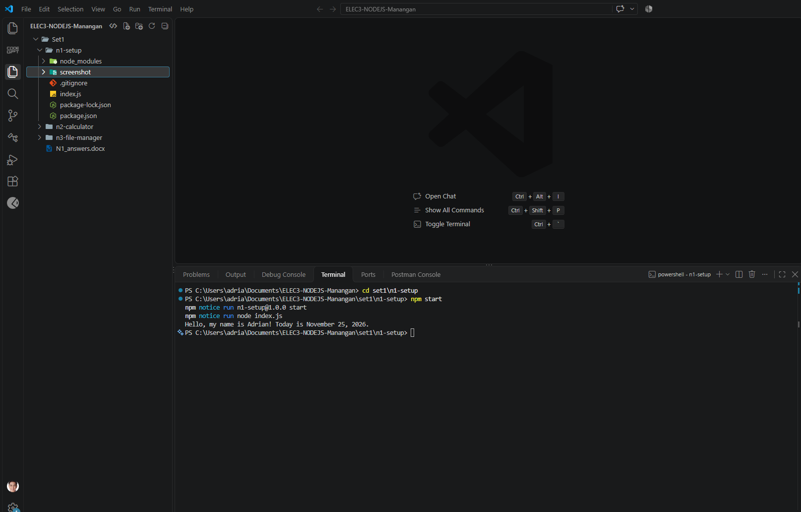
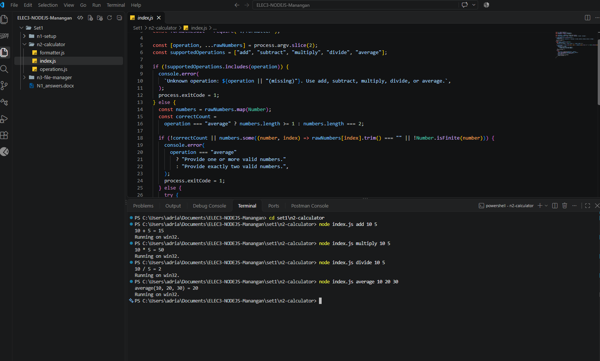
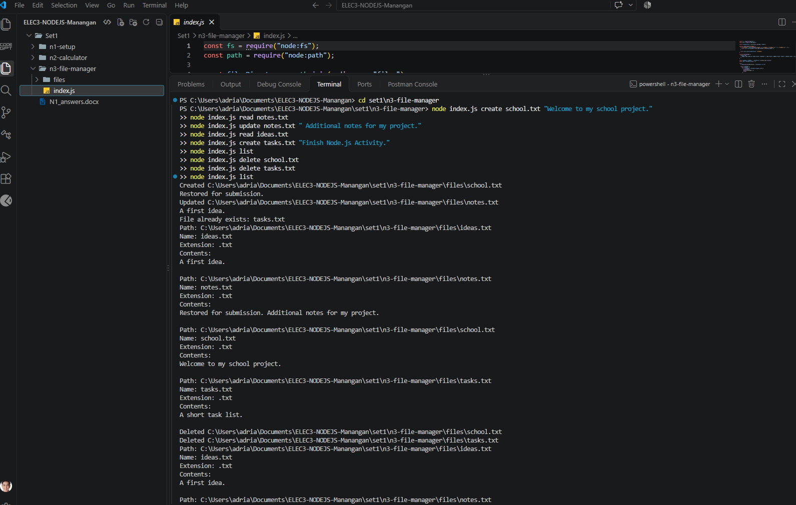

# ELEC 3 - Node.js

Name: Adrian Romeo D. Manangan | Course: ELEC 3 - Node.js

## Activities

| Activity | Description                                                    | Folder                                        |
| -------- | -------------------------------------------------------------- | --------------------------------------------- |
| N1       | Project setup with npm, `package.json`, and installed packages | [Set1/n1-setup](Set1/n1-setup/)               |
| N2       | Modular calculator using custom modules and `process.argv`     | [Set1/n2-calculator](Set1/n2-calculator/)     |
| N3       | File manager using the `fs` and `path` modules                 | [Set1/n3-file-manager](Set1/n3-file-manager/) |

N1 written answers: [N1_answers.docx](Set1/N1_answers.docx)

## How to run

Install [Node.js](https://nodejs.org/) and npm before running these projects. Run each command from a terminal.

### N1

```powershell
cd Set1/n1-setup
npm install
npm start
```

### N2

```powershell
cd Set1/n2-calculator
node index.js add 12 8
node index.js subtract 12 8
node index.js multiply 12 8
node index.js divide 12 8
node index.js average 12 8 4
node index.js divide 12 0
node index.js power 12 8
```

Supported operations: `add`, `subtract`, `multiply`, `divide`, and `average`. The last two commands demonstrate the division-by-zero and unknown-operation errors.

### N3

```powershell
cd Set1/n3-file-manager
node index.js create readme-demo.txt "Hello"
node index.js read readme-demo.txt
node index.js update readme-demo.txt "More text"
node index.js list
node index.js delete readme-demo.txt
```

## Screenshots

### N1



The version check and finished `package.json` screenshots still need to be added.

### N2



The screenshot still needs to show subtraction and both error cases.

### N3


